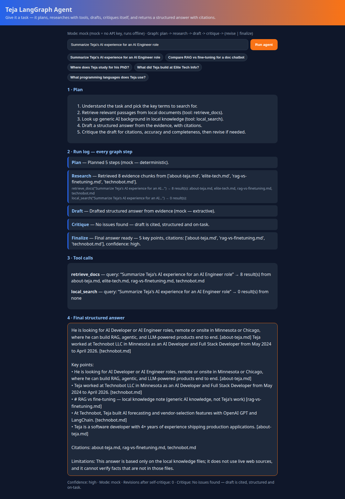

# Teja LangGraph Agent — Product 2

A working **multi-step agentic workflow**, built to learn by building.
Give it a research or job-search task — it plans the steps, calls tools
to retrieve evidence, drafts a structured answer, critiques its own
draft, revises if needed, and returns a final answer with citations.

This is Product 2 of 3 in Teja's 60-day plan to get an AI job in 1–2 months:
Product 1 is a RAG doc chatbot (`../krishnateja-rag-chatbot/`), Product 3 is a
PhD research paper agent — reads a pile of papers, summarizes them, finds
contradictions, and builds a literature review outline with citations.
All three projects are kept open source (MIT).

> **Runs with NO API key.** In mock mode the whole graph runs end-to-end
> (plan → research → draft → critique → final) with deterministic,
> labelled mock drafting and rule-based critique. Add an OpenAI or Azure
> OpenAI key and the same graph calls a real LLM for planning and
> drafting — no code change needed.

## Demo

Screenshot of a real run (mock mode, no API key) — task "Summarize Teja's
AI experience for an AI Engineer role", showing the plan, the run log for
every graph step, the tool calls, and the final structured answer with
citations:



## Live demo

Deploy this repo on Render as a free web service (the `render.yaml` at the
repo root already defines it — no code change needed):

**https://krishnateja-langgraph-agent.onrender.com**

Runs in mock mode with no API key. Note: the free tier sleeps after
15 minutes of inactivity, so the first load after a pause can take
30–60 seconds while the service wakes up.

## The graph

```
START → plan → research → draft → critique
                                   ├─ issues found, revisions < 2 → revise → draft (again)
                                   └─ no issues / max revisions → finalize → END
```

Every node appends to a run log, so you can watch the agent think:
the plan, each tool call and what it returned, the draft, the critique,
any revision, and the final structured answer.

## Folder structure

```
krishnateja-langgraph-agent/
├── backend/
│   ├── agent.py       # LangGraph graph, state, nodes, structured output, LLM client
│   ├── tools.py       # Tools: retrieve_docs, local_search, format_structured
│   ├── main.py        # FastAPI app: /health, /run, /tasks, /
│   └── eval.py        # Eval script: 5 tasks, checks structure + citations + graph
├── frontend/
│   └── index.html     # Single-page UI: plan, run log, tool calls, final answer
├── data/
│   └── knowledge/     # Local knowledge — Teja's own public facts only
│       ├── about-teja.md, technobot.md, elite-tech.md
│       └── rag-vs-finetuning.md   # generic AI knowledge note
├── requirements.txt
├── .env.example       # Copy to .env — never commit real keys
├── LICENSE            # MIT — open source
└── README.md
```

## Run it (5 minutes)

```bash
cd krishnateja-langgraph-agent
python3 -m venv .venv && source .venv/bin/activate
pip install -r requirements.txt

# Demo mode (no key needed):
python -m uvicorn backend.main:app --reload --port 8001
# or: bash run.sh

# Then open http://localhost:8001
```

Try these tasks in the UI (or with curl):
- "Summarize Teja's AI experience for an AI Engineer role"
- "Compare RAG vs fine-tuning for a doc chatbot"
- "Where does Teja study for his PhD?"

```bash
curl -s http://localhost:8001/health
curl -s -X POST http://localhost:8001/run \
  -H 'Content-Type: application/json' \
  -d '{"task": "Compare RAG vs fine-tuning for a doc chatbot"}'
```

## Run the eval

```bash
python backend/eval.py
# Expected in mock mode: 5/5 passed. Writes eval_results.json.
```

## Use a real LLM (optional)

```bash
cp .env.example .env
# Edit .env and set OPENAI_API_KEY=...  (or the AZURE_OPENAI_* values)
# Restart the server. /health will now show mode: "openai" (or "azure").
```

Never put a key in the code, in git, or in a screenshot. `.env` is git-ignored.

## What each part teaches — read the code in this order

### 1. LangGraph state & graphs — `backend/agent.py: AgentState, build_graph()`
State is a `TypedDict` — a shared blackboard every node reads and
updates. Nodes are plain functions that return state updates. Edges say
what runs next; a *conditional* edge after `critique` decides between
`revise` (loop back) and `finalize`. The `log` field uses
`Annotated[list, add]` so each node *appends* to the log instead of
overwriting it.
**Learn:** an agent is a state machine, not a single prompt. If you can
draw the graph on paper, you can debug the agent.

### 2. Planning — `backend/agent.py: plan_node()`
The agent writes a step-by-step plan *before* acting, so its work is
visible and checkable. In mock mode the plan is deterministic; with a
real LLM it is generated from the task.
**Learn:** planning is what separates an agent from a chatbot — and a
bad plan is the first thing to look at when an agent goes wrong.

### 3. Tool-calling — `backend/tools.py` + `backend/agent.py: research_node()`
Three tools, all local and mockable:
- `retrieve_docs` — keyword retrieval over the local knowledge files
  (the same idea as Product 1's RAG retrieval, simplified).
- `local_search` — a curated knowledge lookup for generic AI topics.
  It is *labelled* as local knowledge, not a live web search: if the
  topic is not in the files, it returns nothing instead of inventing.
  A real web-search tool would be swapped in behind this same signature.
- `format_structured` — validates a draft against the Pydantic model.
Every call is recorded in the run log with its query, result count,
and sources.
**Learn:** tools are how an agent touches the world — and logging every
call is how you debug one. A tool that silently invents is worse than
a tool that returns nothing.

### 4. Structured outputs — `backend/agent.py: AgentOutput`
The final answer must match a Pydantic model: `summary`, `key_points`,
`citations`, `confidence`, `limitations`, `mode`. In real mode the LLM
is asked for JSON matching this shape and the result is validated;
in mock mode the extractive draft is built to match it.
**Learn:** downstream code (a UI, a recruiter-facing report, the next
agent in a pipeline) can rely on the shape of an agent's answer. A
fluent paragraph you cannot parse is a bug, not a feature.

### 5. Self-critique loops — `backend/agent.py: critique_node(), _should_revise()`
The critique node checks the draft: are there citations, and are they
actually used in the answer? At least 2 key points? Summary long
enough? On-task? Issues send the graph back to `draft` via `revise`,
at most 2 times — the loop must terminate.
**Learn:** self-critique is a *graph* feature (a node + a conditional
edge), not a prompt trick. And every loop needs a max — an agent that
can revise forever is an agent that never answers.

### 6. Evals — `backend/eval.py`
5 tasks, each checked for (a) valid structured output, (b) an expected
keyword, (c) citations used in the answer text, and (d) the full graph
in the run log (plan, research, draft, critique, finalize) with at
most 2 revisions. Run it after every change.
**Learn:** evals for agents check the *workflow* (did every step run?
did it stop?), not just the final text.

## Stretch exercises (do these next)

1. **Real web search:** replace `local_search` with a real search API
   (e.g. Tavily / DuckDuckGo) behind the same function signature, and
   watch the eval — which tasks get better?
2. **Human in the loop:** add a node after `critique` that pauses and
   asks the user to approve the draft before finalizing.
3. **Memory:** add a LangGraph `MemorySaver` checkpointer so a
   conversation can continue across runs (the import is already
   available — `langgraph.checkpoint.memory`).
4. **Streaming:** stream the run log to the UI as each node finishes,
   instead of returning it all at the end (FastAPI `StreamingResponse`).
5. **Product 3 bridge:** reuse this graph for the PhD research paper
   agent — `research` becomes "read papers", `draft` becomes "literature
   review outline", `critique` checks for contradictions between papers.

## What this project proves (for recruiters)

- LangGraph state machines: nodes, conditional edges, self-critique loops
- Tool-calling with a visible, logged tool interface
- Structured outputs with Pydantic validation
- FastAPI backend, same pattern as Product 1
- Evals that test the workflow, not just the output
- Open source (MIT), documented so another developer can run it

## Facts used in the knowledge files

Only Teja's own public facts: PhD in AI at University of the Cumberlands
(classes started May 2026, in progress); Technobot LLC, May 2024–Apr 2026,
AI forecasting / vendor selection with OpenAI GPT + LangChain, React +
.NET Core inventory app, Azure AD, real-time APIs, CI/CD; Elite Tech Info
Inc, Oct 2023–May 2024, ServiceNow portals / IT asset workflows, REST
APIs, SCCM/JAMF. Plus one generic note on RAG vs fine-tuning. No metrics,
clients, or projects were invented.
